# Invoice Bot for Alegra — DIAN e-invoices → purchase bills, automatically

  

An RPA-style pipeline that reads Colombian electronic invoices (DIAN UBL 2.1) from the ZIP
files suppliers email, validates them, matches every product line against the inventory
catalog and registers the purchase bill in [Alegra](https://www.alegra.com) through its REST
API. Anything the bot is not sure about goes to a **human-review queue with the reason**, never
into the books.

Built for a retail business that handles about **35 supplier invoices and
600 product lines a month**. This repository is a sanitized portfolio version: the logic
is the production logic, and **every company, NIT, product and amount in it is fictitious**.

> **Try it in 30 seconds, no account needed:** `pip install -r requirements.txt && python run_demo.py`

---

## The problem

Every purchase invoice was typed into the ERP by hand:

1. Download the ZIP from the e-mail and open the PDF.
2. Search each product in the catalog. Suppliers use **their own codes**, not the store's,
   so this means searching by name, line by line.
3. Type quantity, price, discount and VAT for every line. Some suppliers bill **boxes of
   12** while the store counts units.
4. Hope the invoice wasn't entered already. Suppliers often e-mail the same invoice twice.

A 40-line invoice took a long time, and the errors were silent: duplicated bills, stock
added to the wrong product, credit notes typed as purchases, prices with the discount
applied twice. Large invoices took the longest, so stock in the system tended to fall behind
stock on the shelf.

## The solution

```mermaid
flowchart LR
    A[ZIP from supplier e-mail] -->|size and zip-bomb limits| B[Extract XML]
    B -->|defusedxml; unwrap AttachedDocument CDATA| C[Parse UBL<br/>Invoice / CreditNote / DebitNote]
    C --> D{Validations}
    D -->|duplicate CUFE / number| X1[Duplicate - skipped]
    D -->|credit or debit note| X2[Skipped - handled as a note]
    D -->|totals don't add up, invalid NIT| R
    D -->|ok| E[Product matching by layers]
    E -->|1 equivalence table NIT + code<br/>2 supplier code<br/>3 EAN barcode<br/>4 fuzzy description| F{All lines<br/>confident?}
    F -->|no| R[Human review queue<br/>with reason + suggestion]
    R -->|decision| L[learn: becomes an<br/>equivalence rule]
    L -.next run.-> E
    F -->|yes| G[Build Alegra bill<br/>pack factors, discounts, VAT ids]
    G -->|--send| H[Alegra API POST /bills]
    G -->|dry-run default| I[Payload saved to disk]
    H --> J[Reports: results.csv,<br/>review_queue.csv, decisions.log]
    I --> J
```



| Stage | Module | What it does |
|---|---|---|
| Read | `zip_reader.py` | Opens ZIPs in memory and never extracts to disk. Limits: 5 MB per member, 20 MB per ZIP, 100:1 compression ratio, no path traversal. |
| Parse | `xml_parser.py` | UBL 2.1 Invoice, CreditNote and DebitNote. Unwraps the real document from the DIAN `AttachedDocument`. Derives unit price and discount from the amounts, because suppliers send price per `BaseQuantity` or add discounts that are only informative. |
| Validate | `validators.py` | Lines vs subtotal vs tax vs payable. NIT format and DIAN check digit. Duplicates by **CUFE**, then by supplier + number. Document type. |
| Match | `matcher.py` | Four layers from most to least trusted. Inactive catalog items are never used. A fuzzy match is accepted only when it is clearly better than the runner-up. |
| Post | `alegra_client.py` | Real client: GETs retried with backoff, **POST never retried** so a timeout can't create a duplicate. A `DryRunClient` with the same interface makes the demo work offline. |
| Report | `reporting.py` | `results.csv` (one row per document), `review_queue.csv` (one row per decision needed, with suggested item and suggested retail price), `decisions.log` (every decision). |

### Key design decisions

- **All-or-nothing bills.** If one line out of 40 is doubtful, the whole invoice waits for
  review. A partial bill would understate stock and accounts payable with no warning.
- **Equivalences are per supplier (NIT + code).** Two suppliers can use the same code for
  different parts. The table also stores a *pack factor*, so 3 boxes × 12 at $228,000
  become 36 units at $19,000.
- **Human in the loop, then learn.** The reviewer fills `decision_item_id` in
  `review_queue.csv`, and `python -m invoice_bot learn` turns those decisions into
  equivalence rules. The same code is automatic next month, and the share of automatic
  lines grows over time.
- **Numbers matter in fuzzy matching.** Model numbers weigh double, and two descriptions with
  different numbers are penalized, so *"FILTER CB125"* never matches *"FILTER CB190"*.
- **Derive, don't trust.** The discount % is computed as `1 − net / (price × qty)` and not
  read from the XML percentage fields. In production, some suppliers declare discounts that
  are not actually applied.
- **Fail loudly on API constraints.** Rules learned from Alegra rejections are checked
  before posting: an inactive item rejects the whole bill, and a due date before the issue
  date is invalid.
- **Safe by default.** Dry-run is the default and live mode needs an explicit `--send`.
  Credentials live only in `.env`, and XML is parsed with `defusedxml`.

More detail in [`docs/architecture.md`](docs/architecture.md) and the
[case study](docs/case_study.md).

---

## Quick start

```bash
git clone https://github.com/StevenK20/invoice-automation-alegra.git
cd invoice-automation-alegra
python -m venv .venv && source .venv/bin/activate      # Windows: .venv\Scripts\activate
pip install -r requirements-dev.txt

python run_demo.py            # or: make demo
```

The demo runs in **dry-run mode** over `sample_data/invoices/`: 8 fictitious documents
covering the cases the bot has to handle.

| Sample | Case | Expected result |
|---|---|---|
| `01_normal_DAP1001.zip` | Codes and EAN barcodes found in the catalog | processed |
| `02_discounts_LUB2210.zip` | Line discounts, price per BaseQuantity, **box of 12** via equivalence | processed |
| `03_credit_note_NCA77.zip` | Credit note referring to DAP1001 | skipped (not a purchase) |
| `04_duplicate_resend_DAP1001.zip` | Same invoice e-mailed again (same CUFE) | duplicate |
| `05_unknown_product_IMP5501.zip` | Unknown code + ambiguous description + low-confidence name | needs review |
| `06_totals_mismatch_LUB2231.zip` | Header subtotal doesn't match the lines | needs review |
| `07_bare_xml_fuzzy_FYC310.xml` | Bare XML, unknown codes, descriptions match with high confidence | processed (fuzzy) |
| `08_corrupt_file.zip` | Not a real ZIP | error |

<details>
<summary>Demo output</summary>

```text
Mode: DRY-RUN: nothing is sent; payloads are written to output/dry_run_payloads/
Input: sample_data/invoices
PROCESSED    DAP1001   01_normal_DAP1001.zip/adDAP1001.xml | dry-run: payload saved, nothing sent
PROCESSED    LUB2210   02_discounts_LUB2210.zip/adLUB2210.xml | dry-run: payload saved, nothing sent
SKIPPED      NCA77     03_credit_note_NCA77.zip/adNCA77.xml | credit note (refers to DAP1001): register it as a supplier credit/debit note, not as a purchase bill
DUPLICATE    DAP1001   04_duplicate_resend_DAP1001.zip/adDAP1001.xml | CUFE already registered (8d0130e26d0ba390...)
NEEDS_REVIEW IMP5501   05_unknown_product_IMP5501.zip/adIMP5501.xml | 3 of 3 line(s) need a product decision
   line 1 IM-77801       -> REVIEW: Unknown product: code 'IM-77801' not in catalog or equivalences
   line 2 IM-90001       -> REVIEW: Similar name to item 301 'KIT ARRASTRE 428 CB 125 ESTANDAR DEMO' (88%), but item 302 is also 88%
   line 3 IM-55511       -> REVIEW: Similar name to item 303 'ESPEJO RETROVISOR PLEGABLE NEGRO PAR DEMO' (80%), confirm before linking
NEEDS_REVIEW LUB2231   06_totals_mismatch_LUB2231.zip/adLUB2231.xml | Lines add up to 211,200.00 but the invoice subtotal is 245,000.00
PROCESSED    FYC310    07_bare_xml_fuzzy_FYC310.xml | dry-run: payload saved, nothing sent
ERROR        -         08_corrupt_file.zip | File is not a zip file
------------------------------------------------------------------------------
Documents read: 8
  duplicate     1
  error         1
  needs_review  2
  processed     3
  skipped       1
Product lines: 14 | matched without intervention: 11 (79%)
  by layer: standard_code=3, supplier_code=3, equivalence=3, fuzzy=2
```
</details>

Outputs go to `output/`. A copy of the generated reports is in
[`docs/sample_output/`](docs/sample_output/), and that folder also has a bill payload
exactly as it would be POSTed to Alegra (`bill_LUB2210.json`).

### Use it with your own files

```bash
python -m invoice_bot run --input path/to/zips --catalog my_catalog.csv --equivalences my_equivalences.csv
```

- **Dry-run by default.** Add `--send` to really create bills. First copy `.env.example`
  to `.env` and set `ALEGRA_EMAIL` / `ALEGRA_TOKEN`.
- **Close the review loop.** Fill `decision_item_id` (and `decision_pack_factor` if the
  supplier sells boxes) in `output/review_queue.csv`, then run:

  ```bash
  python -m invoice_bot learn --review output/review_queue.csv --equivalences my_equivalences.csv
  ```
- **Regenerate the fictitious samples** with `python scripts/generate_samples.py`.

### Run the tests

```bash
python -m pytest -q          # or: make test   -> 44 passed
```

| Area | What the tests cover |
|---|---|
| Validators | DIAN check digit, malformed NITs, totals within rounding tolerance, blocking vs warning issues, duplicates by CUFE and by number, credit notes |
| Matcher | Each of the four layers, supplier-specific equivalences, inactive items, ambiguous fuzzy matches, numeric-token rule |
| Parsing and ZIP | AttachedDocument unwrapping, discounts, BaseQuantity, credit notes, bare XML, XML entity bomb, oversized members, path traversal |
| Pipeline | End-to-end status of all 8 samples, dry-run sends nothing, pack-factor conversion, review queue content |

CI runs the tests and the demo on Python 3.10 and 3.12 (`.github/workflows/tests.yml`).

---

## Results

Measured in production from **1 October to 6 November 2026** (63 purchase bills, 522 product lines):

| Metric | Before (manual) | After (bot) |
|---|---|---|
| Time per invoice | ~30 min | ~2 min (download, dry-run check, send) |
| Time for a batch of 10 invoices | ~5 hours | ~20 min |
| Monthly effort at ~35 invoices | ~17.5 h | ~1.2 h (**~93 % less**) |
| Lines matched automatically on the first pass | — | **76 %** (397 of 522); the rest resolved in the review queue and learned as rules |
| Duplicate bills prevented (invoice already registered) | — | **57** |
| Other silent errors caught | — | box-to-unit conversions, inactive catalog items, due date before issue date |

The share of automatic lines keeps growing: every review decision becomes an equivalence
rule, so the same supplier code is matched without help the next time.

---

## Project structure

```
├── src/invoice_bot/
│   ├── zip_reader.py      # safe ZIP/XML extraction
│   ├── xml_parser.py      # UBL 2.1 -> models (defusedxml)
│   ├── models.py          # dataclasses: Invoice, InvoiceLine, MatchResult, ...
│   ├── validators.py      # totals, NIT check digit, CUFE duplicates, document type
│   ├── matcher.py         # layered product matching + review reasons
│   ├── pricing.py         # suggested retail price for new products
│   ├── alegra_client.py   # Alegra REST client + offline DryRunClient
│   ├── pipeline.py        # orchestration, all-or-nothing rule, decision log
│   ├── reporting.py       # CSV reports and summary
│   └── cli.py             # demo | run | learn
├── sample_data/           # fictitious catalog, equivalences, Alegra mock, 8 invoices
├── scripts/generate_samples.py
├── tests/                 # pytest suite
├── docs/                  # architecture, case study, demo video script, sample output
├── run_demo.py            # one-command demo
├── .env.example           # credential names only, no values
└── requirements*.txt, pyproject.toml, Makefile
```

## Production version vs. this repository

The production tool, which is not published, adds features specific to one business. They
were left out here to keep the portfolio focused and free of company data:

- a Gmail downloader for supplier ZIPs
- a small Tkinter desktop launcher for non-technical staff
- automatic creation of missing suppliers and products
- supplier price lists used to translate supplier codes into barcodes
- inventory clean-up tools: duplicate merging, warehouse consolidation, cost review

## Author

**Kevin Stiven Rojas Bello** — automation & RPA developer

- GitHub: [@StevenK20](https://github.com/StevenK20)
- LinkedIn: [linkedin.com/in/stevenk20](https://www.linkedin.com/in/stevenk20)

Open to automation, RPA and ERP-integration projects.

## License

MIT. Sample data is fictitious and generated by `scripts/generate_samples.py`.
