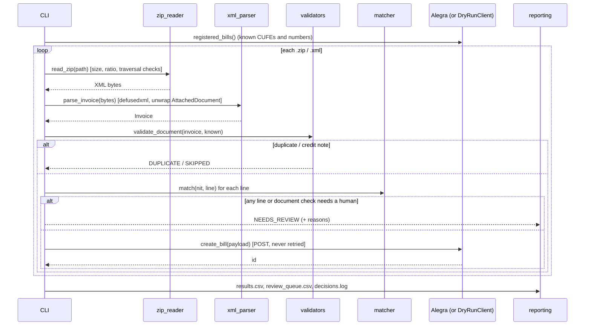

# Architecture

## Data flow

## Statuses

| Status | Meaning | What a person does |
|---|---|---|
| `processed` | Bill created, or in dry-run the payload was written | nothing |
| `needs_review` | At least one blocking reason. Reasons can be at line level (product) or document level (totals, unknown supplier, VAT rate) | decide in `review_queue.csv`, then run `learn` |
| `duplicate` | CUFE, or supplier + number, already registered | nothing |
| `skipped` | Credit or debit note | register it as a note in the ERP |
| `error` | Corrupt file, not a UBL document, or API error | check the file or retry |

## Matching layers

| Layer | Key | Confidence | Notes |
|---|---|---|---|
| `equivalence` | (supplier NIT, normalized supplier code) | 1.00 | Human decision. Carries `pack_factor`. If it points to an inactive item, the line goes to review. |
| `supplier_code` | normalized supplier code = catalog reference or barcode | 1.00 | `normalize_code` removes spaces, dashes and a trailing `.00`, which catalog exports often add. |
| `standard_code` | EAN in `StandardItemIdentification` | 0.98 | |
| `fuzzy` | token similarity on description | score | Auto-accepted when ≥ 0.90 **and** at least 0.10 above the runner-up. Between 0.55 and 0.90 it is a suggestion for review. |

The similarity is a weighted token F1:
- Letters and digits are split, so `CB125F` becomes `CB 125 F`.
- Accents are stripped and Spanish stopwords removed.
- Tokens with digits weigh 2×.
- If both descriptions contain numbers and none are shared, the score drops by 0.3.

## Security

- `defusedxml` for every parse, including the document embedded inside the AttachedDocument.
- ZIP members are read in memory with limits:
  - 5 MB per member, re-checked against the real bytes read, not only the header
  - 20 MB per archive
  - a 100:1 compression ratio and at most 50 members
  - no absolute or `..` paths
- Credentials only through environment variables (`.env`, git-ignored).
- Dry-run by default. Live mode requires `--send`.
- `.gitignore` excludes `invoices/`, `real_data/` and `output/` so real documents are never committed.

## Extending

- **Another ERP:** implement the four methods of the `AlegraAPI` protocol
  (`provider_id`, `tax_id`, `registered_bills`, `create_bill`).
- **Catalog from the API instead of CSV:** build `Catalog([...CatalogItem])` from a
  paginated `GET /items`.
- **Withholdings / other charges:** `PAYABLE_DIFFERS` is already reported as a non-blocking
  warning, ready to be mapped to accounting categories.
